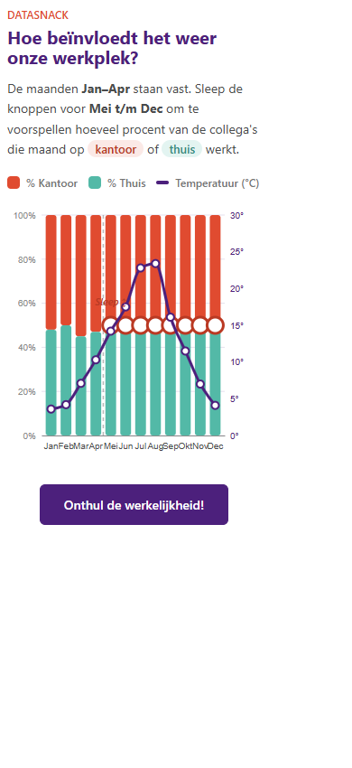

# Airco Effect

An interactive Power BI custom visual that invites users to predict monthly office attendance before revealing the example data. It combines a draggable 100% stacked chart for office and remote work with a monthly temperature line.

## Features

- Drag the office/remote-work boundary from May through December; January through April provide the initial reference.
- Reveal the bundled example values and compare them with your prediction.
- View monthly average temperature alongside workplace distribution.
- Use mouse or touch input in a responsive visual layout.

## Install

1. Download `Airco-Effect.1.0.0.0.pbiviz` from this folder.
2. In Power BI Desktop, open the **Visualizations** pane and select **Import a visual from a file**.
3. Select the downloaded `.pbiviz` file and add the visual to your report.

The visual uses bundled example data and does not require fields from a report data model.

## Technology

Microsoft Power BI Custom Visuals API, React, and D3.js.
