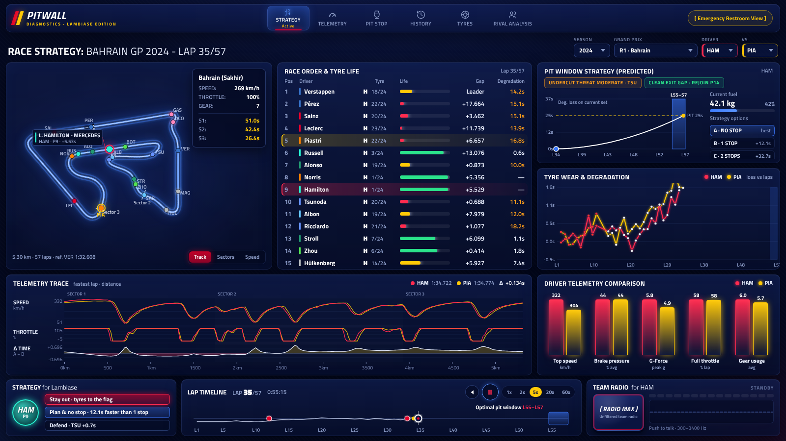

# F1 Pitwall - Lambiase Edition

An F1 post-race analysis and strategy project built with Python and Power BI. It combines public race results and telemetry with derived physics, tyre analysis, and an interactive custom visual.

## What it does

- Compares drivers across lap times, sectors, speed, and telemetry.
- Estimates longitudinal and lateral G-forces and brake pressure from public telemetry. These are derived estimates, not official sensor readings.
- Models tyre degradation and pit loss, then explores alternative stop strategies and predicted pit windows.
- Replays race data in a React-based Power BI custom visual, with a responsive layout and telemetry views.

## Data and architecture

Jolpica provides race results and pit stops; OpenF1 provides historical lap timing and telemetry. A Python ETL transforms the data into Parquet files and a star schema for Power BI Import mode. The repository includes sample output for eight Grands Prix.

The public copy intentionally excludes the copyrighted team-radio recording. The radio control falls back to synthesized bleeps and squelch.

## Try it

1. Install Python dependencies with `pip install -r requirements.txt`.
2. Copy `sample_data/star` to `C:\F1PitWall\data\star`, or change the `DataFolder` parameter in `powerbi/F1PitWall.SemanticModel/definition/expressions.tmdl` to the sample-data folder on your machine.
3. Open `pitwall.pbip` in Power BI Desktop and refresh the model.
4. To run the physics and tyre tests, use `python -m pytest -q tests`.

To rebuild the custom visual, use Node.js 18 or newer, install the dependencies in `visual`, clear any local radio clip with `npm run embed-audio -- --clear`, then run `npm run typecheck` and `pbiviz package`. Import the resulting `.pbiviz` file into Power BI Desktop.
