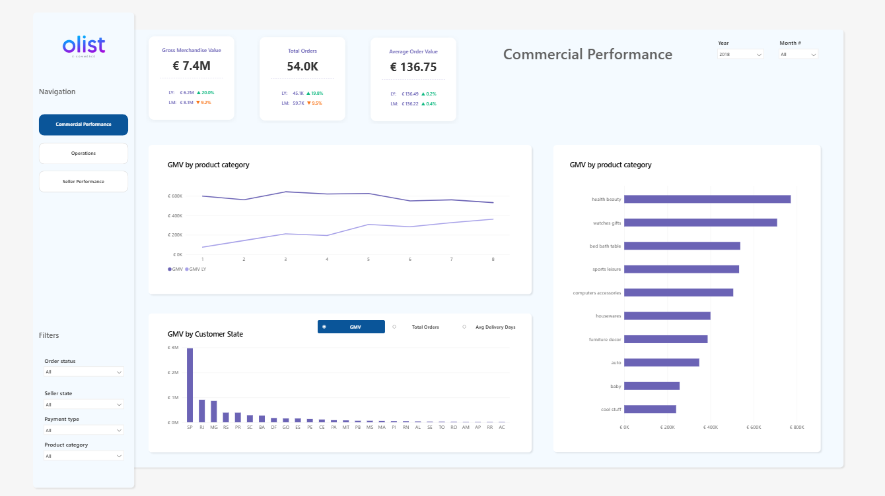
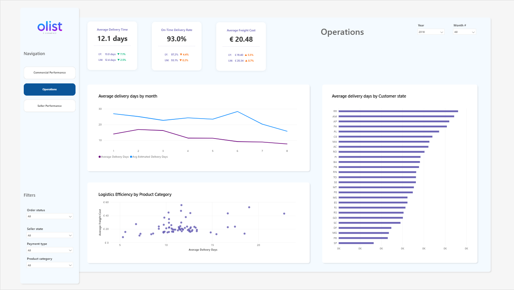
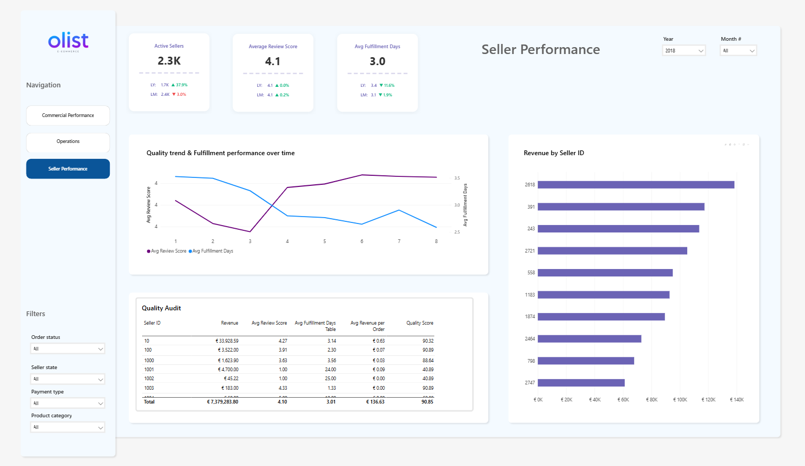
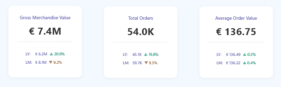

# Olist E-Commerce Analytics Dashboard

A comprehensive Power BI analytics solution for the Olist marketplace, transforming raw data into actionable business intelligence across commercial performance, operational efficiency, and seller quality metrics.

## Project Overview

The core objective was to transform raw Olist marketplace data into a multi-layered management tool. Leadership needed to track standard commercial growth while simultaneously monitoring operational efficiency and individual merchant quality.

## Business Requirements & Problem Statement

### Key Requirements

**Commercial Performance:** Track sales volume (GMV), order counts, and Average Order Value (AOV) with historical Year-over-Year (YoY) and Month-over-Month (MoM) benchmarks.

**Operational Health:** Monitor bottlenecks by comparing actual delivery times against customer expectations across different regions.

**Seller Quality Audit:** Build a diagnostic tool to evaluate individual seller performance, separating high-volume/high-quality partners from high-risk merchants who pull down the platform's reputation.

## Solution Architecture

The solution was structured into a clean, 3-page interactive report with a unified navigation experience:

### 📊 Page 1: Commercial Performance

Employs high-level KPI cards with context indicators (Last Year / Last Month trends). It features a dynamic breakdown by product category and geographical performance.

### 🚚 Page 2: Operations

Visualizes logistics by mapping delivery delays. A scatter plot ("Logistics Efficiency by Product Category") pairs delivery time with freight costs to highlight outliers.

### ⭐ Page 3: Seller Performance

Contains a granular "Quality Audit" matrix. This view isolates top earners and calculates a custom operational score, preventing low-volume "one-hit wonders" or distortion from premium pricing (AOV) from skewing the quality baseline.

### Interactive Navigation

Dynamic card navigation system with smooth transitions between dashboards:

## Key Analytical Insights & Strategic Recommendations

### Take-Aways

**Geographic Concentration:** Sales (GMV) are heavily concentrated in a single state (SP), leaving a massive untapped market in other regions.

**Logistics Bottlenecks:** Certain states (e.g., RR, AM, AP) suffer from average delivery times exceeding 20–25 days, significantly higher than the platform average of 12.1 days.

**High-Risk Top Sellers:** The Quality Audit table successfully isolated critical operational failures. For example, Seller 1001 generates significant revenue (€4,700.00) but maintains a disastrous review score (1.00) and an unacceptable fulfillment delay (24 days), resulting in a low Quality Score (40.89).

### Recommended Actions

**Merchant Intervention:** Use the Quality Audit table to flag and contact underperforming high-revenue sellers (like Seller 1001 and 1002). Implement strict SLAs or temporary suspensions to protect the platform's brand equity.

**Targeted Seller Activation:** Build out an automated campaign tracking "Dormant Sellers" (registered merchants with €0 revenue) to identify onboarding friction and stimulate supply.

**Logistics Re-routing:** Partner with regional fulfillment centers or local 3PL providers in North/Northeast states (RR, AM, AP) to close the gap between estimated and actual delivery dates.

## Technical Implementation

### DAX & Context Transition

Formulated advanced measures using CALCULATE, DIVIDE, and time-intelligence logic to evaluate complex data across disconnected granularities (Orders vs. Items vs. Reviews).

### Field Parameters

Implemented dynamic visual toggles (e.g., GMV by Customer State chart), allowing end-users to swap the entire metric of a chart between GMV, Total Orders, and Avg Delivery Days with a single click.

### Custom Quality Score Metric

Built a balanced, live-reacting operational score that dynamically penalizes slower fulfillment speeds relative to customer review trends.

### UI/UX Design

- Clean, corporate grid layout
- Synchronized left-hand navigation
- Collapsible filter panes
- Custom-designed conditional formatting to optimize scannability

## Files Included

- **Olist.pbix** - Power BI model with all dashboards and measures
- **page1.png** - Commercial Performance dashboard screenshot
- **page2.png** - Operations dashboard screenshot
- **page3.png** - Seller Performance dashboard screenshot
- **html_cards.gif** - Interactive navigation animation

## Technical Stack

- **Power BI Desktop** - Data visualization and analytics
- **DAX** - Advanced calculations and measures
- **M Query** - Data transformation

---

*This project demonstrates enterprise-level analytics design combining business acumen with technical excellence in data storytelling.*
